

  
  
  

<h1 align="center">The Seed</h1>

<b>Blockchain/Data infrastructure — L0 chain, smart contracts, on-chain game assets</b>

  <code>ANTI-NETRUNNER</code> — Source integrity hashing prevents automated AI scraping and unauthorized code replication. Full source available on request with identity verification.

  
  
  
  
  
  
  

---

## The Chain in 3D

  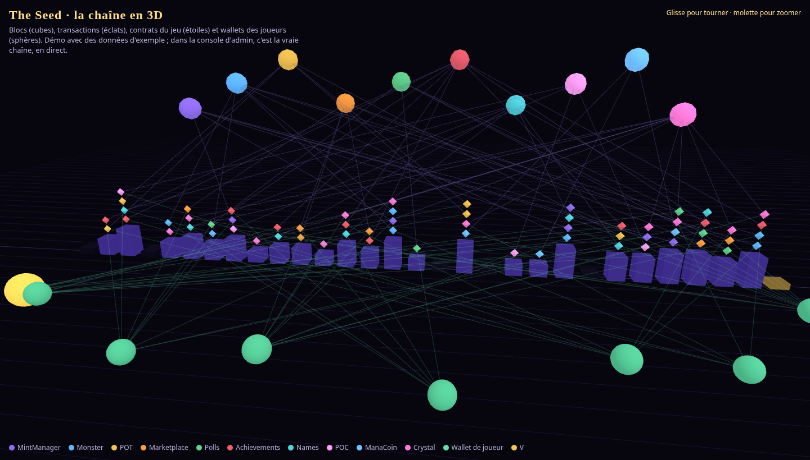

Live 3D visualization of the L0 blockchain — wallets, blocks, transactions, AI agents, all rendered in three.js

---

## What is The Seed?

An evolving **Blockchain/Data** infrastructure, and its first application: a monster-collecting game where monsters, runes and items are **tokenized assets** you truly own, on-chain. Your identity is a **wallet**; trades between players go through **smart contracts** (escrow, auctions, on-chain royalties); every action is **signed for free** (gasless) and relayed by the game.

### Stack

| Layer | What's inside |
|---|---|
| ⛓️ **Smart contracts** | Solidity · Foundry · OpenZeppelin UUPS — tokens, NFT monsters, on-chain **marketplace** (auctions, offers, escrow), polls, achievements · 261 contract test files, upgrade-safe |
| 🐍 **Backend** | Python · FastAPI · PostgreSQL · web3.py — SIWE login, encrypted wallet vaults, indexer, deterministic battle engine, 450+ species, 575+ stages, 272 backend test files |
| 🎮 **Game** | Expo · React Native (mobile + web) — summons, runes, dungeons, tower, world boss, guilds, marketplace (UI V2), 88 test files |
| 🖥️ **Admin console** | React · wagmi · **three.js** — live 3D view of the chain with wallets, block explorer, players, market, AI agents |
| 🤖 **AI** | ALICE automation, agent runs, MCP servers — the project is built to run itself |
| ✅ **Quality** | 4.5K+ unit test files, 18 browser walks on an isolated stack, security and licence scans, balance simulation |

### Numbers

  
  
  
  
  
  
  

---

## Game Screenshots

  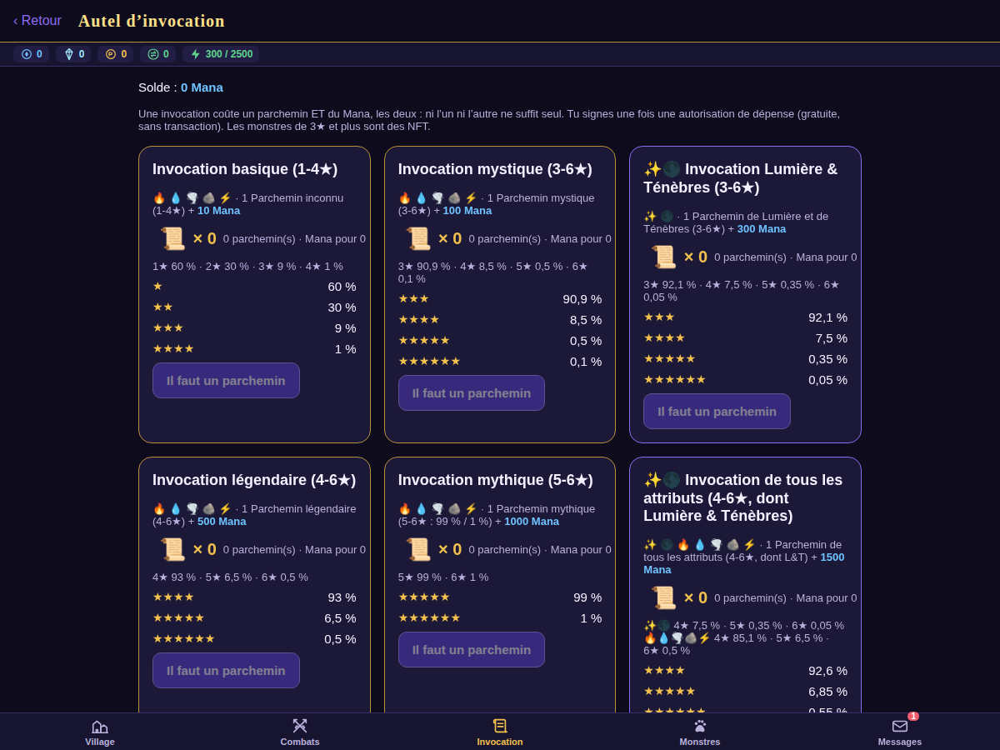
  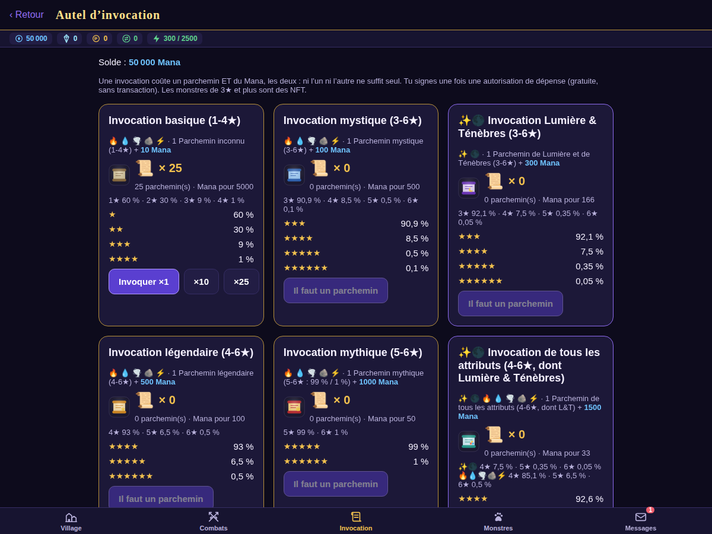
  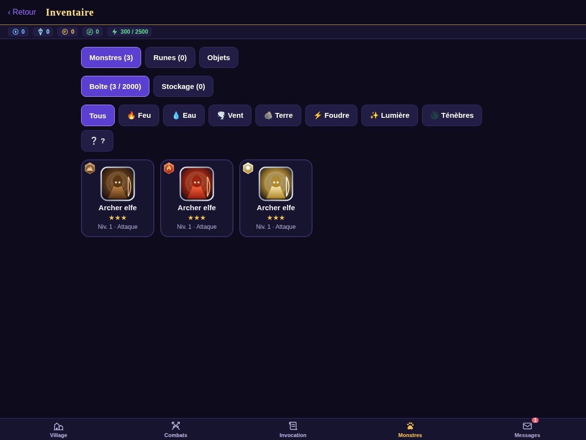

Summon screen · Altar · Inventory — V2 design

  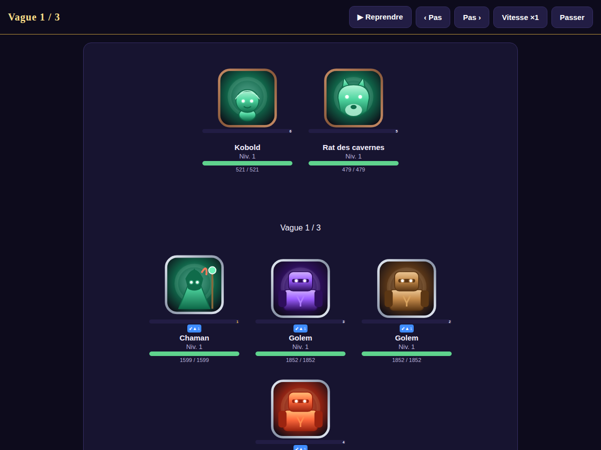
  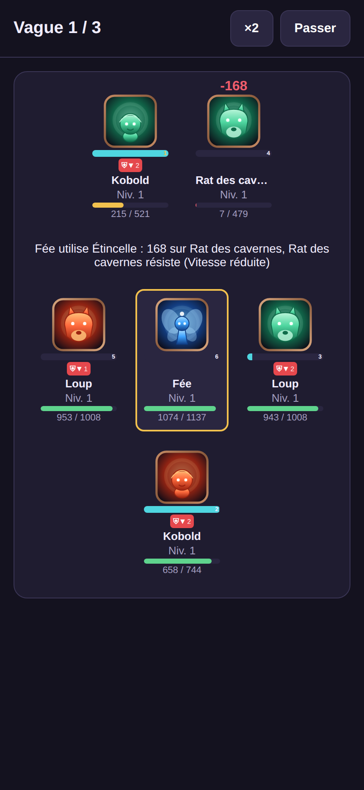
  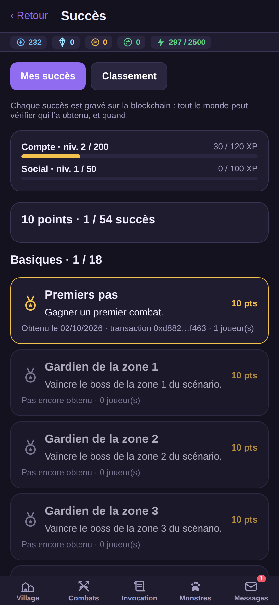

Battle (paused) · Battle (live) · Achievements

  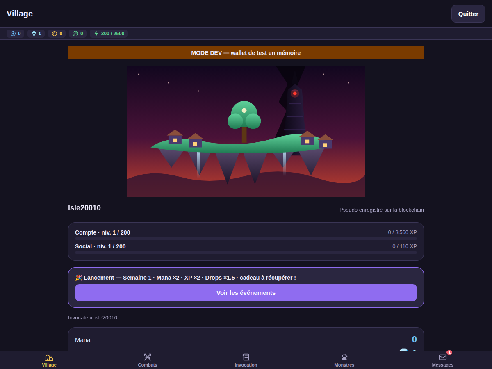

The Village — floating island (V2 art, will be replaced)

---

## Marketplace — Real On-Chain Trading

  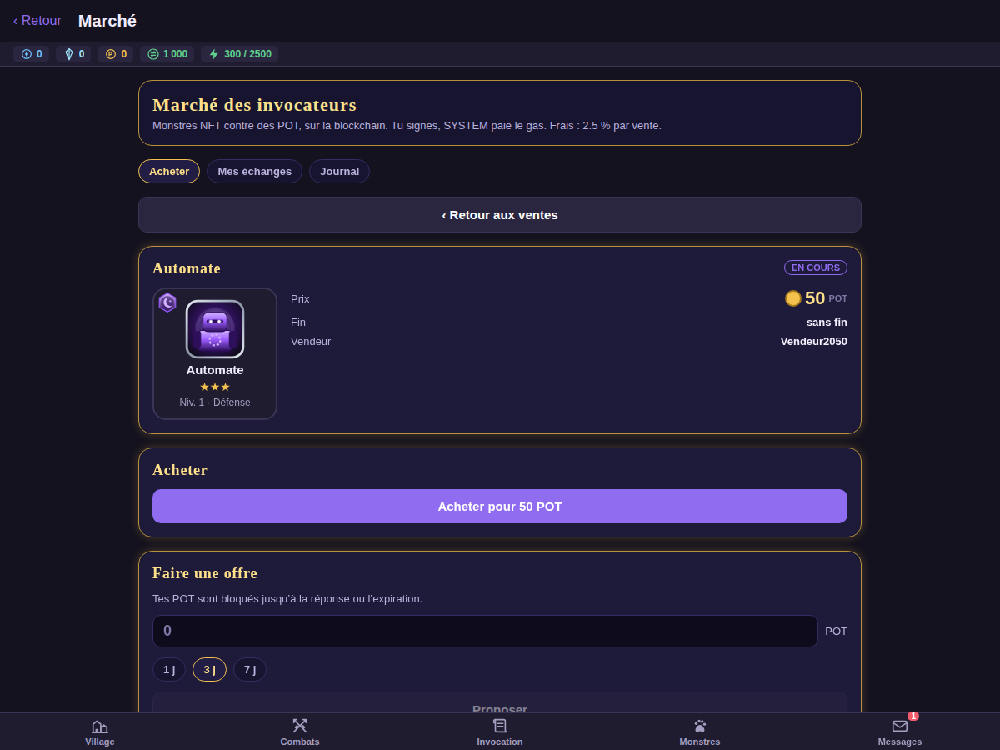
  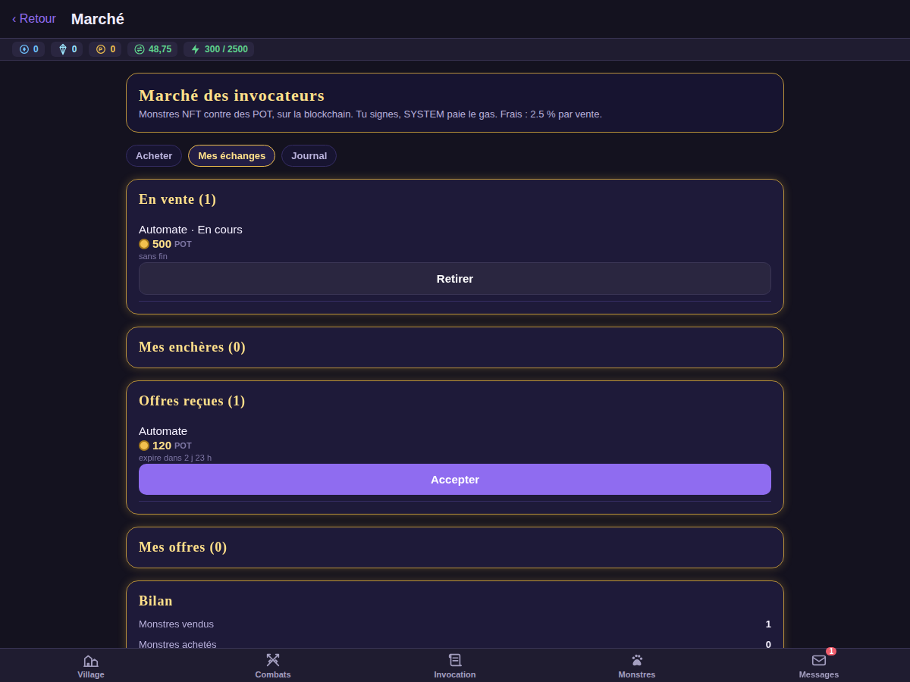
  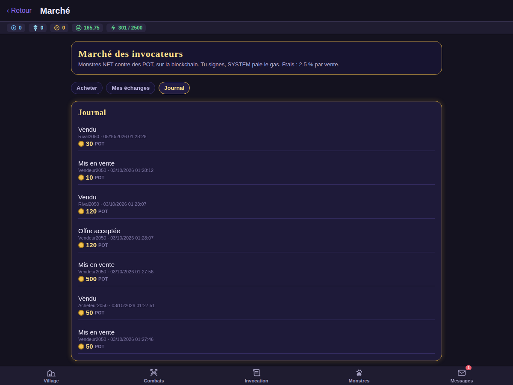

Listing a sale · Offer received · Trade journal — every transaction on-chain

The marketplace is a tested version of how **any asset** could be traded without a middleman:

| Step | In The Seed | Same mechanism for a real ticket |
|---|---|---|
| **Issue** | Only `MintManager` mints a monster NFT, within a daily budget | Organizer mints exactly 5K tickets, nobody can add one |
| **List** | Player signs a fixed-price sale or auction (anti-sniping) | Fan lists at face value; contract can cap the price |
| **Swap** | Escrow: monster + payment locked and swapped in one tx | Money and ticket change hands at once — no scam |
| **Share** | 2.5% of each sale goes to the creator, shown before signing | 5% of every resale goes to the artist, forever |
| **Prove** | Every sale is public on the chain, with full history | Provenance and authenticity checkable by anyone |

The contracts are upgrade-tested, covered by invariant tests (no asset is ever lost or created by a trade) and wait for an audit. **Real value needs audits and a legal frame first.**

---

## Chain Details

| Property | Value |
|---|---|
| Chain | L0 — chain ID 31337 |
| Consensus | Foundry / Anvil (dev), upgradeable for production |
| Gas | Gasless — all transactions relayed |
| Upgrades | UUPS (OpenZeppelin) — upgrade-safe, proxy pattern |
| Tokens | POC (contribution), MANA (in-game), NFT Monsters, NFT Items |
| Testing | 261 contract test files, invariant tests, upgrade simulation |

---

## Related

  
  
  

---

<i>Design By V0</i>

